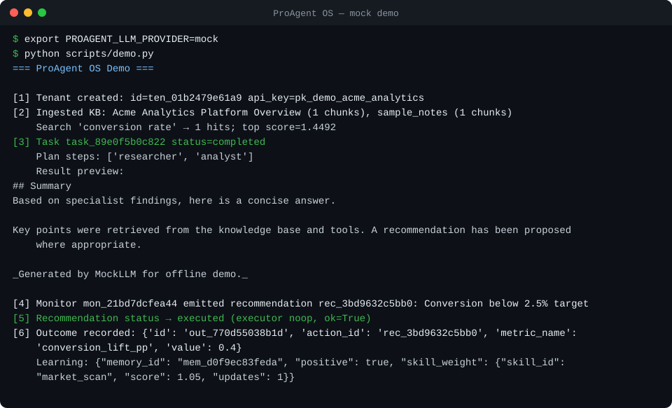
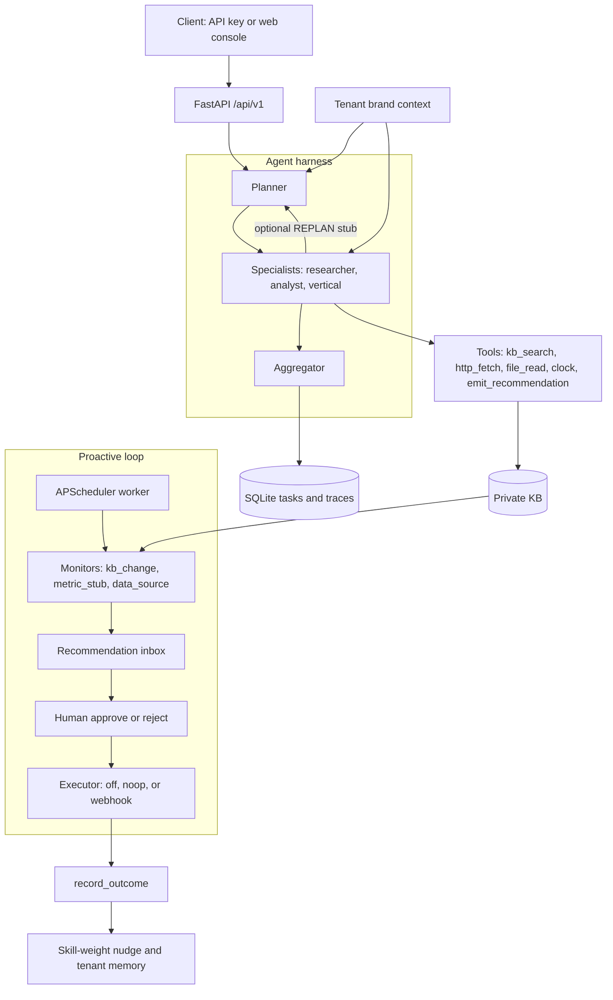

# ProAgent OS

[](LICENSE)
[](https://www.python.org/)
[](https://github.com/jahonn/ProAgent-OS/issues)
[](https://github.com/jahonn/ProAgent-OS/actions/workflows/ci.yml)

**Self-hosted harness for commercial agent products.** A planner–specialist loop, a private knowledge base, proactive human approval, and a small outcome loop, exposed as a multi-tenant FastAPI app.

Product name: **ProAgent OS** (`proagent-os`). Original design and code. It is an independent project and is not affiliated with any third-party agent product.

> Status: **MVP / early open source** (0.1.1). Suitable for demos, scaffolding vertical packs, and self-hosted experiments. Read the [roadmap (issue #2)](https://github.com/jahonn/ProAgent-OS/issues/2) before any production SaaS use. History: [CHANGELOG.md](CHANGELOG.md).
>
> **Releases / Changelog:** Upcoming **v0.1.1** (first public GitHub Release): [docs/RELEASE_NOTES_v0.1.1.md](docs/RELEASE_NOTES_v0.1.1.md). Canonical detail: [CHANGELOG.md](CHANGELOG.md) `[0.1.1]`.

**Scan:** [Who it is for](#who-it-is-for) · [Quick start](#quick-start-mock-llm) · [Positioning](#positioning) · [Architecture](#architecture) · [Retrieval](#retrieval-modes) · [Roadmap](#roadmap)

## Who it is for

- Product teams packaging a vertical agent (support, sales, ops research) who want tenants, a private KB, and an approval inbox in one service.
- Engineers who want an offline mock run first, then the same HTTP API against any OpenAI-compatible `/v1/chat/completions` endpoint.
- Builders who will add a vertical pack (`verticals/<name>/` agents and skills) without editing the harness.
- Early adopters who can live with one SQLite file, stub embeddings, and an executor that is off, a local noop, or one configured webhook.

## Quick start (mock LLM)

Mock LLM, no API keys. The offline script is the one-minute path to a green run. Step-by-step output is in [docs/DEMO.md](docs/DEMO.md).

[](docs/DEMO.md)

Recorded with `PROAGENT_LLM_PROVIDER=mock` (no API key): `python scripts/demo.py`, then a short `python scripts/demo_support_desk.py` beat. Same session: [`docs/demo.cast`](docs/demo.cast) (`asciinema play docs/demo.cast`). Re-record with `python scripts/record_demo.py`.

```bash
git clone https://github.com/jahonn/ProAgent-OS.git
cd ProAgent-OS
python3 -m venv .venv
source .venv/bin/activate   # Windows: .venv\Scripts\activate
pip install -r requirements.txt
pip install -e .

python scripts/demo.py      # offline demo → data/demo.db (gitignored)
```

You should see a completed task, a recommendation titled `Conversion below 2.5% target` that the default noop executor marks executed, and a dashboard snapshot. Ids change every run. The demo tenant key is `pk_demo_acme_analytics`.

Two more offline packs use the same mock provider: `python scripts/demo_support_desk.py` (support policies) and `python scripts/demo_ops_incident.py` (on-call runbooks). Neither needs an API key.

Serve that same database (the demo key lives in `data/demo.db`, not in a fresh file):

```bash
export PROAGENT_ADMIN_KEY=dev-admin-key
export PROAGENT_LLM_PROVIDER=mock
export PROAGENT_DB_PATH=./data/demo.db
uvicorn proagent_os.main:app --host 0.0.0.0 --port 8080

# optional proactive worker (separate process, same DB)
python -m proagent_os.worker
```

Open http://localhost:8080 and paste `pk_demo_acme_analytics`. API docs: http://localhost:8080/docs.

To start from an empty database instead, set `PROAGENT_DB_PATH=./data/proagent.db` and create a tenant:

```bash
curl -s -X POST http://localhost:8080/api/v1/tenants \
  -H "Authorization: Bearer dev-admin-key" \
  -H "Content-Type: application/json" \
  -d '{"name":"Acme","goals":"Grow conversion","tone":"concise"}'
```

Use the returned `api_key` as `Authorization: Bearer …` for tenant APIs.

## Positioning

ProAgent OS is a runnable product harness: private KB, proactive human-in-the-loop, an outcome log, and FastAPI tenants. LangChain-style libraries and CrewAI-style crews are toolkits for assembling agent behavior; you bring the product shell. Pick the toolkit when you want that composability.

| | ProAgent OS | LangChain-style libraries | CrewAI-style crews |
|---|---|---|---|
| What you run | A harness: API, worker, console, SQLite | A library of chains, tools, retrievers, and graphs | A library of role-based agents, tasks, and crews |
| Agent shape | Planner → specialists (native tool calls) → aggregator | The graph or chain you compose | The crew and tasks you define |
| Knowledge | Per-tenant KB. BM25 by default; optional offline hybrid stub | Retrievers and stores you connect | Knowledge sources you attach |
| Proactive HITL | Interval monitors file recommendations; approve can run a noop or one configured webhook | Human-input steps you add to your graph | Human-input steps you add to your crew or flow |
| Task-run HITL | Pause to `awaiting_human`; approve runs the gated tool once, then continues mid-loop when checkpointed (OpenAI / LangGraph / Anthropic shaped); reject cancels without running it | Interrupt / human-in-the-loop nodes you wire | Human-input / approval steps you add |
| Session compaction | Stub: summarize older turns, keep last N raw (`PROAGENT_COMPACTION_*`) | Session / thread memory you configure | Memory / context window tools you add |
| Plan-and-replan | Stub: optional outer replan after specialists (`PROAGENT_REPLAN_*`, default off) | Plan-and-execute / replan nodes you wire | Crew replanning you add |
| Outcome loop | `record_outcome` stores a metric and nudges a skill weight | Evaluation in the tools you place around the library | Evaluation in the tools you place around the library |
| Tenancy | FastAPI `/api/v1` and one Bearer API key per tenant | Your service owns auth and tenancy | Your service owns auth and tenancy |
| This release | v0.1.1 early MVP. Approve can run a noop or a configured webhook. It does not run action code | Large ecosystem; production shape is yours | Large ecosystem; production shape is yours |

## Architecture

Harness loop phases, industry mapping, task-run HITL mid-loop resume, session/context compaction stub, tool schema hardening, plan-and-replan outer loop stub, and stub vs planned eval hooks: [docs/ARCHITECTURE.md](docs/ARCHITECTURE.md) (`LoopPhase` / `tool_trajectory` / `hitl` / `compaction` / `replan` in `proagent_os/harness/`). Golden-task / ordered-subset trajectory CI stub: [docs/EVAL.md](docs/EVAL.md). Conversation compaction knobs: [docs/MEMORY.md](docs/MEMORY.md). Tool JSON-schema validation: [docs/TOOLS.md](docs/TOOLS.md).

Planner and aggregator stay text-only. Specialists call tools natively, for up to `PROAGENT_MAX_TOOL_ROUNDS` rounds (JSON-in-content is still accepted).



**Built-in tools:** `http_fetch` · `file_read` · `kb_search` · `clock` · `emit_recommendation` · `request_run_approval`

**Core agents:** `planner` · `researcher` · `analyst` · `aggregator` (plus agents merged from `verticals/*/agents/`)

## Features

| Layer | In this MVP |
|-------|-------------|
| **Agent harness** | Planner → specialists → aggregator. YAML registry. Native OpenAI-style tool calls (multi-round). SQLite tasks and traces. |
| **Professional** | Ingest URL/HTML and md/txt/html/pdf (PDF is best-effort). BM25, plus an optional offline hybrid stub. Brand context and skill packs. |
| **Proactive** | Interval monitors (`kb_change`, `metric_stub`, `data_source`). Recommendation inbox. Approve/reject API. APScheduler worker. Approve can run a noop or webhook executor and writes `recommendation_audit`. |
| **Profitable** | `record_outcome`. Skill-weight nudges and tenant-memory feedback (a score nudge, not a trained policy). Dashboard API. |
| **Commercial surface** | FastAPI `/api/v1`, one Bearer API key per tenant (rotate and revoke), in-process rate-limit stub, web console, Docker Compose. |

## Real LLM (OpenAI-compatible)

Any OpenAI-compatible `/v1/chat/completions` endpoint works (OpenAI, Xiaomi Mimo Token Plan, DeepSeek, vLLM, and others).

```bash
cp .env.example .env
# edit .env — never commit it

export PROAGENT_LLM_PROVIDER=openai
export PROAGENT_LLM_BASE_URL=https://api.openai.com/v1   # or your /v1 endpoint
export PROAGENT_LLM_API_KEY=sk-...
export PROAGENT_LLM_MODEL=gpt-4o-mini
export PROAGENT_MAX_TOOL_ROUNDS=8

python scripts/demo_live.py   # prints multi-round tool traces
```

## Docker Compose

```bash
export PROAGENT_ADMIN_KEY=dev-admin-key
docker compose up --build
```

- API/UI: http://localhost:8080
- Services: `api` + `worker` sharing a SQLite volume. Startup applies schema migrations on that file.
- This path starts a fresh database volume. Create a tenant with the curl above; it does not load `data/demo.db`.
- Backup and restore: [docs/DATABASE.md](docs/DATABASE.md).

## Environment variables

| Variable | Default | Meaning |
|----------|---------|---------|
| `PROAGENT_ADMIN_KEY` | `dev-admin-key` | Bootstrap / list tenants. Also mints a replacement key after revoke |
| `PROAGENT_AUTH_MODE` | `api_key` | `api_key` (default) or `oidc` (sketch; no identity-provider call). See [docs/AUTH.md](docs/AUTH.md) |
| `PROAGENT_OIDC_ISSUER` | empty | Issuer URL. Required only when `PROAGENT_AUTH_MODE=oidc`. Matched against JWT `iss` |
| `PROAGENT_OIDC_AUDIENCE` | empty | Expected JWT `aud`. Required only for `oidc` |
| `PROAGENT_OIDC_CLIENT_ID` | empty | Public OAuth client id for a future code flow. Required only for `oidc`. Not a secret |
| `PROAGENT_RATE_LIMIT_ENABLED` | `true` | In-process fixed window on `/api/v1`. `false` turns it off |
| `PROAGENT_RATE_LIMIT_REQUESTS` | `120` | Requests allowed per window, per bucket |
| `PROAGENT_RATE_LIMIT_WINDOW_SECONDS` | `60` | Fixed window length in seconds |
| `PROAGENT_DB_PATH` | `./data/proagent.db` | SQLite path |
| `PROAGENT_LLM_PROVIDER` | `mock` | `mock` or `openai` (OpenAI-compatible) |
| `PROAGENT_LLM_BASE_URL` | `https://api.openai.com/v1` | Compatible `/v1` base |
| `PROAGENT_LLM_API_KEY` | empty | Bearer token; empty → mock fallback |
| `PROAGENT_LLM_MODEL` | `gpt-4o-mini` | Model id |
| `PROAGENT_MAX_TOOL_ROUNDS` | `8` | Max tool rounds per specialist |
| `PROAGENT_TOOL_SCHEMA_STRICT` | `true` | Validate tool args against JSON schema before execute ([TOOLS.md](docs/TOOLS.md)) |
| `PROAGENT_REPLAN_ENABLED` | `false` | Outer plan-and-replan stub; default off = zero behavior change ([ARCHITECTURE.md](docs/ARCHITECTURE.md)) |
| `PROAGENT_REPLAN_MAX` | `1` | Max replan cycles per task when enabled |
| `PROAGENT_REPLAN_FORCE` | `false` | Fixture/demo only: force replan while under max |
| `PROAGENT_EXECUTOR_MODE` | `noop` | `off`, `noop`, or `webhook` |
| `PROAGENT_EXECUTOR_ON_APPROVE` | `true` | Run the executor as part of approve when mode is not `off` |
| `PROAGENT_EXECUTOR_WEBHOOK_URL` | empty | Absolute http(s) URL. Required for `webhook`. This is the only request target |
| `PROAGENT_EXECUTOR_WEBHOOK_TIMEOUT_S` | `5` | Webhook timeout in seconds |
| `PROAGENT_EXECUTOR_WEBHOOK_TOKEN` | empty | Optional Bearer token for the webhook |
| `PROAGENT_KB_RETRIEVAL` | `bm25` | `bm25`, `hybrid`, or `vector` |
| `PROAGENT_KB_EMBED_BACKEND` | `stub` | `stub` (offline hash-bag) or `openai` (`POST /v1/embeddings`) |
| `PROAGENT_KB_EMBED_DIMS` | `64` | Vector width, 1–4096. Sent as `dimensions` for `openai` |
| `PROAGENT_KB_EMBED_MODEL` | `text-embedding-3-small` | Model id for `openai`. Ignored by `stub` |
| `PROAGENT_KB_EMBED_BASE_URL` | empty | Embeddings `/v1` root. Empty uses `PROAGENT_LLM_BASE_URL` |
| `PROAGENT_KB_EMBED_API_KEY` | empty | Bearer token. Empty uses `PROAGENT_LLM_API_KEY` |
| `PROAGENT_KB_HYBRID_ALPHA` | `0.5` | Hybrid mix: `α * norm(vector) + (1 - α) * norm(BM25)` |
| `PROAGENT_KB_VECTOR_STORE` | `blob` | `blob` (Python cosine) or `sqlite_vec` (optional `vec0` index) |
| `PROAGENT_SKILLS_DIRS` | `./skills,./verticals/example/skills,./verticals/support_desk/skills,./verticals/ops_incident/skills` | Skill pack roots |
| `PROAGENT_AGENTS_CONFIG` | `./config/agents.yaml` | Core agent registry |
| `PROAGENT_OTEL_ENABLED` | `false` | OpenTelemetry spans. `false` does not import `opentelemetry` |
| `PROAGENT_OTEL_EXPORTER` | `console` | `console`, `otlp`, or `none`. Used only when spans are enabled |
| `PROAGENT_OTEL_EXPORTER_OTLP_ENDPOINT` | empty | OTLP HTTP trace URL, for example `http://localhost:4318/v1/traces` |
| `PROAGENT_OTEL_SERVICE_NAME` | `proagent-os` | `service.name` resource attribute |

## Database

Tenant data lives in one SQLite file, `PROAGENT_DB_PATH` (default `./data/proagent.db`). The API and the worker open that file on startup and apply any schema migrations that are not yet recorded in `schema_migrations`. The same step is available while the server is stopped:

```bash
python -m proagent_os.migrations
```

A file created by the older `CREATE TABLE IF NOT EXISTS` startup is stamped at version 1. Existing rows stay in place. Later migrations still run. sqlite-vec `vec0` tables are created by the vector store when that store is selected; migrations do not load the `vec` extra.

Copy the database file while the API and worker are stopped. To take a snapshot while the process is running, use SQLite's backup API (`Connection.backup`, or the `sqlite3` shell's `.backup` when that shell is installed). Details, including WAL sidecars and restore, are in [docs/DATABASE.md](docs/DATABASE.md).

## Observability and usage

Spans and usage totals are optional hooks. The default install does not import OpenTelemetry and does not contact a payment provider.

```bash
pip install 'proagent-os[otel]'
export PROAGENT_OTEL_ENABLED=true
export PROAGENT_OTEL_EXPORTER=console   # or otlp, or none
# export PROAGENT_OTEL_EXPORTER_OTLP_ENDPOINT=http://localhost:4318/v1/traces
```

With the flag off, `span()` returns immediately and ProAgent does not import the OpenTelemetry SDK. With the flag on and the extra missing, a warning is logged and spans stay no-ops, so boot still succeeds. Current FastAPI releases import `opentelemetry-api` themselves; the SDK and the OTLP exporter stay in the `otel` extra. The traced calls are the HTTP request, KB search, recommendation approve and execute, and each LLM chat. Span attributes are the method, path, status code, tenant id, retrieval mode, model name, and token count. Prompt text, KB query text, and API keys are left off the span.

`console` prints spans and is enough for a local demo. `otlp` uses the HTTP exporter. An empty `PROAGENT_OTEL_EXPORTER_OTLP_ENDPOINT` leaves endpoint selection to the standard `OTEL_EXPORTER_OTLP_*` variables. `none` builds spans and does not export them. The Compose file passes these variables through; the published image does not install the `otel` extra.

Usage events are rows in `usage_events` (migration `0003_usage_events`): `tenant_id`, `kind` (`llm_tokens`, `kb_search`, `recommendation_execute`), `quantity`, and `created_at`. KB search and a successful recommendation execute each store quantity `1`. LLM rows store `usage.total_tokens` when the provider sends it, otherwise `prompt_tokens` + `completion_tokens`. The mock provider sends no usage block, so the quantity is `len(text) // 4` (at least 1 when there is text or a tool call). That number is an offline stand-in, not a provider invoice.

`GET /api/v1/usage` with a tenant bearer returns that tenant's totals. The admin key returns every tenant, or one tenant when `tenant_id` is set. The body is labeled `"billing": "stub"` and `"payment": null`. It does not create a charge.

## Retrieval modes

Search defaults to offline BM25. That path does not write embeddings and does not call an embeddings API. CI runs this path with `PROAGENT_LLM_PROVIDER=mock` and `PROAGENT_KB_EMBED_BACKEND=stub`.

| Mode | Behavior |
|------|----------|
| `bm25` | Lexical BM25 only. Does not call the embeddings backend. |
| `hybrid` | `α * norm(cosine) + (1 - α) * norm(BM25)`. Each signal is divided by its max over the candidate set (non-positive values contribute 0). |
| `vector` | Cosine similarity on stored embeddings. |

`stub` (the default) is a pure-Python hash-bag, not a semantic model. `openai` POSTs to `{base}/embeddings` on an OpenAI-compatible `/v1` root. The base URL and API key come from `PROAGENT_KB_EMBED_BASE_URL` and `PROAGENT_KB_EMBED_API_KEY` when those are set, and otherwise from `PROAGENT_LLM_BASE_URL` and `PROAGENT_LLM_API_KEY`. The JSON body sends `model` (`PROAGENT_KB_EMBED_MODEL`) and `dimensions` (`PROAGENT_KB_EMBED_DIMS`). `text-embedding-3-*` accepts `dimensions`; set the width to a size that model allows (1536 is the native width of `text-embedding-3-small`). The call times out after 90 seconds. The error text for a failed call does not include the API key.

`hybrid` and `vector` store one vector per chunk on ingest. The stored model label is `stub`, or the configured embeddings model id. If any chunk is missing a vector, the stored width does not match `PROAGENT_KB_EMBED_DIMS`, or the stored model label does not match the active embedder, search uses BM25. `KnowledgeBase.reindex_embeddings()` rewrites the active store and is safe to repeat. Run it after changing the backend, model, dimensions, or vector store.

`PROAGENT_KB_VECTOR_STORE` chooses where those vectors live:

| Store | Behavior |
|-------|----------|
| `blob` (default) | Float32 BLOBs in `kb_chunk_embeddings`. Cosine runs in Python. No extra package, and sqlite-vec is not imported. |
| `sqlite_vec` | Optional `vec` extra. A `vec0` table per width (`kb_vec_d{dims}`), cosine distance, partitioned by `tenant_id`. Hybrid and vector search use that index. |

```bash
pip install 'proagent-os[vec]'   # sqlite-vec>=0.1.9
```

sqlite-vec 0.1 `vec0` KNN runs inside the extension (exhaustive, not HNSW) and one query returns at most 4096 neighbors. At or below that size, hybrid asks for a native cosine on every chunk and uses the same fusion formula as the blob store. Above it, vector mode returns the nearest `top_k` (capped at 4096), and hybrid fuses full-corpus BM25 with native scores for the nearest 4096 chunks; the rest contribute 0. Scores can differ from Python cosine in the last digits because the extension uses float32.

If `sqlite_vec` is selected and the package is missing or the extension fails to load, hybrid and vector ingest/search raise `VectorStoreConfigError`. The KB routes return HTTP 503. They do not fall back to the blob cosine path. BM25 does not load the extension, including when the store is set to `sqlite_vec`. Switching store or dimensions does not copy existing vectors; reindex the tenant afterward. pgvector is not wired.

A missing key, a missing base URL, or a failed embeddings call raises `EmbeddingsConfigError` or `EmbeddingsError`. The openai backend does not silently switch to the stub. `POST /api/v1/kb/ingest/*` and `POST /api/v1/kb/search` return HTTP 503 with that message. BM25 keeps working if you leave the backend on `openai` and only switch `PROAGENT_KB_RETRIEVAL` back. The mode is process-wide via the environment, not a field on `POST /api/v1/kb/search`.

```bash
# Offline default (CI and the mock demo)
export PROAGENT_KB_RETRIEVAL=bm25
export PROAGENT_KB_EMBED_BACKEND=stub

# Hybrid search against an OpenAI-compatible embeddings API
export PROAGENT_KB_RETRIEVAL=hybrid
export PROAGENT_KB_EMBED_BACKEND=openai
export PROAGENT_KB_VECTOR_STORE=blob
# Optional native index. Requires pip install 'proagent-os[vec]'.
# export PROAGENT_KB_VECTOR_STORE=sqlite_vec
export PROAGENT_KB_EMBED_MODEL=text-embedding-3-small
export PROAGENT_KB_EMBED_DIMS=1536
export PROAGENT_LLM_BASE_URL=https://api.openai.com/v1
export PROAGENT_LLM_API_KEY=sk-...
# Optional dedicated endpoint. When unset, the LLM base URL and API key are used.
# export PROAGENT_KB_EMBED_BASE_URL=https://api.openai.com/v1
# export PROAGENT_KB_EMBED_API_KEY=sk-...
export PROAGENT_KB_HYBRID_ALPHA=0.5
```

## Repository map

```
proagent-os/
├── proagent_os/
│   ├── main.py              # FastAPI app + web UI
│   ├── worker.py            # Proactive scheduler process
│   ├── harness/             # Orchestrator, registry, memory
│   ├── llm/                 # mock + OpenAI-compatible + tool_calls
│   ├── professional/        # KB, skills, tools, brand
│   ├── proactive/           # Monitors, recommendations, scheduler
│   ├── profitable/          # Metrics + learning stub
│   ├── api/                 # REST /api/v1/*
│   ├── observability.py     # optional OpenTelemetry facade (no-op by default)
│   ├── metering.py          # SQLite usage stub (no payment provider)
│   └── web/                 # Console UI
├── config/agents.yaml
├── skills/
├── verticals/example/       # Minimal vertical pattern
├── verticals/support_desk/  # Support desk pack (policies, triage, demo)
├── verticals/ops_incident/  # On-call pack (runbooks, triage, demo)
├── scripts/demo.py · demo_live.py · demo_support_desk.py · demo_ops_incident.py · record_demo.py
├── docs/DATABASE.md · DEMO.md · EVAL.md · MEMORY.md · TOOLS.md · VERTICAL_SKILL.md · demo.cast · demo.svg
├── tests/
└── docker-compose.yml
```

## Add a vertical pack

1. Create `verticals/<your_vertical>/agents/agents.yaml`. Startup merges every `verticals/*/agents/agents.yaml`. Core agents stay in `PROAGENT_AGENTS_CONFIG`.
2. Add `verticals/<your_vertical>/skills/<id>/SKILL.md` (optional `run.py`).
3. Append that skills directory to `PROAGENT_SKILLS_DIRS` if it is not already listed. The default includes `verticals/example/skills`, `verticals/support_desk/skills`, and `verticals/ops_incident/skills`.
4. Restart the API and worker from the repo root. No other core code changes are required.

| Pack | Agent | Skills | Demo |
|------|--------|--------|------|
| `verticals/example/` | `market_scout` | `market_scan` | Minimal pattern. No separate script. |
| `verticals/support_desk/` | `support_triage` | `ticket_triage`, `policy_lookup` | `python scripts/demo_support_desk.py` |
| `verticals/ops_incident/` | `incident_commander` | `incident_triage`, `runbook_lookup` | `python scripts/demo_ops_incident.py` |

Startup merges every `verticals/*/agents/agents.yaml`, including `ops_incident`, in sorted path order (`example`, then `ops_incident`, then `support_desk`). `verticals/support_desk/` is a support-desk pack with sample policies. `verticals/ops_incident/` is an on-call pack with sample runbooks. Both demos use the mock LLM and need no API key. They are MVP demos, not a production helpdesk or paging system.

File-by-file steps for that layout, the startup merge, `PROAGENT_SKILLS_DIRS`, and a mock-LLM smoke test are in [docs/VERTICAL_SKILL.md](docs/VERTICAL_SKILL.md).

## Authentication

Demo and curl commands on this page stay on `PROAGENT_AUTH_MODE=api_key`: send `Authorization: Bearer` with the admin key or a tenant API key. That path is unchanged.

The admin key is role `admin`. A new tenant key is role `tenant_operator`. An admin can set `tenant_readonly` with `PUT /api/v1/tenants/{tenant_id}/role`. Readonly can read recommendations and usage, and cannot approve or rotate. `PROAGENT_AUTH_MODE=oidc` is a sketch: startup fails until issuer, audience, and client id are set, and the process still does not call an identity provider. Roles, the routes that check them, and what is stub versus planned are in [docs/AUTH.md](docs/AUTH.md).

## API overview

- `POST /api/v1/tenants` (admin) · `GET /api/v1/tenants/me` (includes `role`) · `GET /api/v1/tenants` (admin; includes `key_status` and `role`, not the secret)
- `PUT /api/v1/tenants/{tenant_id}/role` (admin) sets `tenant_operator` or `tenant_readonly` for that tenant API key. See [docs/AUTH.md](docs/AUTH.md).
- `POST /api/v1/tenants/me/api-key/rotate` and `POST /api/v1/tenants/me/api-key/revoke` (tenant bearer). Admin equivalents: `POST /api/v1/tenants/{tenant_id}/api-key/rotate` and `.../revoke`.
- Rotate is a hard cutover. The response includes the new `api_key` once, and the previous bearer returns 401 on the next call. There is no grace window. Revoke returns 401 `Invalid API key` for that bearer (same error as an unknown key). The tenant cannot undo a revoke; an admin rotate on that tenant id mints a replacement. `tenant_api_key_audit` and process logs store a short prefix and a SHA-256, not the raw key.
- `/api/v1/*` is rate limited in-process (default 120 requests / 60 seconds). Buckets are per tenant id, plus separate admin and unrecognized-bearer buckets. Over the limit the body is `{"detail":"Rate limit exceeded"}` with `Retry-After`. Counters reset when the process restarts and are not shared across workers. Redis is not used. `/health` is not limited.
- `GET /api/v1/agents` · `GET /api/v1/agents/tools`
- `POST /api/v1/tasks` · `GET /api/v1/tasks` · `GET /api/v1/tasks/{id}` · `POST /api/v1/tasks/{id}/pause|resume|reject` — run-level HITL (`running`→`awaiting_human`→ continue/`completed`/`cancelled`). A gated tool pause stores a snapshot (`tool` + validated `arguments`) in `pending_action` (never a URL or shell command) plus an orchestrator checkpoint. Default resume runs that tool once (`PROAGENT_HITL_EXECUTE_ON_APPROVE`) and continues the specialist loop when a checkpoint exists (`PROAGENT_HITL_RESUME_CONTINUE`). An execute receipt keeps a retry from running it again; an in-flight receipt returns 409 unless the body sets `reexecute`. Reject cancels and does not run the tool. Resume/reject reuse `recommendation.decide` RBAC.
- `POST /api/v1/kb/ingest/url|text|file` · `POST /api/v1/kb/search`
- `GET /api/v1/skills` · `POST /api/v1/skills/{id}/invoke`
- `POST /api/v1/monitors` · `POST /api/v1/monitors/{id}/run`
- `GET /api/v1/recommendations` · `POST .../approve|reject|decide` — strict transitions (`pending` → `approved`/`rejected`, `approved` → `executed`). Approve may include `execution: {ok, mode, error?}`. A failed webhook stays `approved` (HTTP 200) and writes `execute_failed`. Illegal transitions are HTTP 400.
- `POST /api/v1/metrics/outcomes` · `GET /api/v1/usage` (metering stub; tenant bearer, or admin for all tenants / `?tenant_id=`) · `GET /api/v1/dashboard`

## Tests

```bash
pip install -r requirements.txt
pip install -e .
pytest -q
```

CI runs `pytest -q` on Python 3.11 and 3.12 with `PROAGENT_LLM_PROVIDER=mock`. It does not install the `vec` or `otel` extras. The sqlite-vec extension test is marked `sqlite_vec` and skips when the package is missing or the extension cannot load. Blob-store and index-wiring tests still run. OpenTelemetry tests keep the SDK import off unless `PROAGENT_OTEL_ENABLED=true`.

## Contributing

1. Fork and create a feature branch
2. Keep changes focused; add or adjust tests when behavior changes
3. Do **not** commit `.env`, API keys, or tenant databases
4. Open a PR against `main`

Details: [CONTRIBUTING.md](CONTRIBUTING.md). Bug reports and feature ideas: [GitHub Issues](https://github.com/jahonn/ProAgent-OS/issues) (templates provided).

## Roadmap

Commercial-readiness work and the path toward a more discoverable project are tracked in **[issue #2](https://github.com/jahonn/ProAgent-OS/issues/2)**.

Known gaps in this tree:

- sqlite-vec is an optional `vec0` index (`PROAGENT_KB_VECTOR_STORE=sqlite_vec`, extra `vec`). It is not HNSW, and one KNN query returns at most 4096 neighbors. pgvector is not wired. Default search remains BM25. The default vector store remains the offline blob plus Python cosine. Remote embeddings are available with `PROAGENT_KB_EMBED_BACKEND=openai`.
- A production IdP. Roles and an OIDC sketch are in [docs/AUTH.md](docs/AUTH.md): the default remains the admin key and tenant API keys, and `oidc` mode does not call an identity provider. Authorization-code login, JWKS verification, and gating every write route are still open. A shared quota service is not built. Recommendation decisions write `recommendation_audit`. API key issue, rotate, and revoke write `tenant_api_key_audit`. `/api/v1` has an in-process rate-limit stub (no Redis).
- Multi-node deploy. SQLite stays a single-writer file. Schema migrations run on startup; backup and restore are in [docs/DATABASE.md](docs/DATABASE.md).
- Recommendation executors beyond noop and one operator-configured webhook (no per-action code, no URL taken from the action payload)
- A real evaluation harness (the learning loop is score nudges)
- A payment provider. `usage_events` and `GET /api/v1/usage` are a metering stub (`billing: stub`) and do not create charges. OpenTelemetry export is optional (`pip install 'proagent-os[otel]'`, `PROAGENT_OTEL_ENABLED=true`) and stays off in the default install.
- A richer product UI and i18n
- First public GitHub Release **v0.1.1** — [release notes](docs/RELEASE_NOTES_v0.1.1.md), [CHANGELOG](CHANGELOG.md) `[0.1.1]`. The annotated tag is cut from the merged commit ([issue #2](https://github.com/jahonn/ProAgent-OS/issues/2)).

## Security

- Never commit `.env` or API keys
- Rotate any key that was pasted into chat or logs. `POST /api/v1/tenants/me/api-key/rotate` invalidates the previous tenant key immediately. `POST /api/v1/tenants/me/api-key/revoke` disables it until an admin calls `POST /api/v1/tenants/{tenant_id}/api-key/rotate`. Logs and `tenant_api_key_audit` keep a prefix and SHA-256, not the raw key.
- The rate limit is a per-process stub. It is not a billing quota and it does not survive a restart. `GET /api/v1/usage` is a separate SQLite counter, also not a quota and not a charge.
- OpenTelemetry span attributes include the tenant id, model name, and token count. They omit prompt text, knowledge-base query text, and API keys. Leave `PROAGENT_OTEL_ENABLED` false unless you intend to export that metadata.
- Approve and execute are privileged. A tenant API key with role `tenant_operator` (the default) can trigger the configured executor. `tenant_readonly` cannot approve, reject, execute, or rotate that key. Other write routes are not role-gated yet. Treat an operator key like a write credential. See [docs/AUTH.md](docs/AUTH.md).
- `webhook` mode POSTs only to `PROAGENT_EXECUTOR_WEBHOOK_URL`. The recommendation `action` JSON is body data. It is not a URL, a shell command, or code. Redirects and environment proxies are disabled for that call.
- Webhook receivers should treat `recommendation_id` as an idempotency key. A crash after a successful POST can retry the same recommendation.
- Set `PROAGENT_EXECUTOR_MODE=off` when approve should record a decision and nothing else. Leave `PROAGENT_EXECUTOR_WEBHOOK_TOKEN` empty unless the receiver requires it. The token is not copied into the audit row or the API response.

## License

MIT — see [LICENSE](LICENSE).
