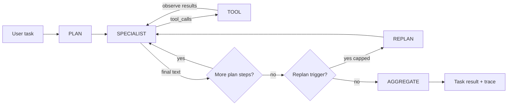
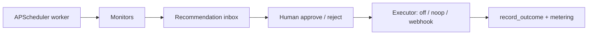
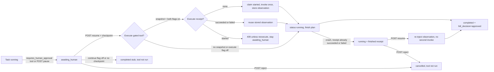
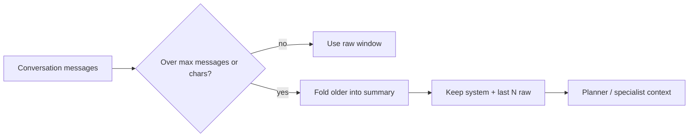
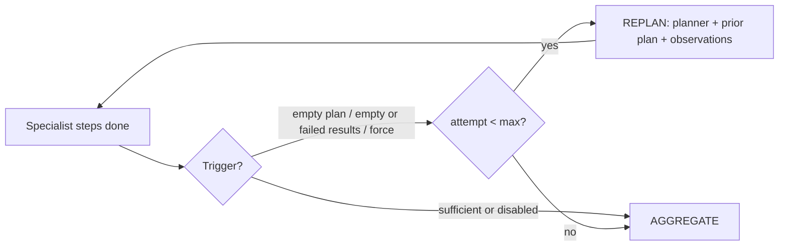

# Architecture — agent harness loop

ProAgent OS is a **product harness**, not a chain library. The runtime that
matters commercially is the explicit agent loop: plan, call specialists with
tools, observe results, then decide a final answer — with a separate proactive
path that asks a human before side effects.

This document maps that loop to public patterns from major agent platforms and
papers, and points at the thin code hooks in `proagent_os/harness/loop.py`.

## Outer loop (task run)

| Phase | Wire value | Who | Notes |
| --- | --- | --- | --- |
| Plan | `plan` | Planner agent (text-only) | Emits JSON steps `{agent, goal, tools}` |
| Specialist | `specialist` | Researcher / analyst / vertical | One LLM turn; may request tools |
| Tool | `tool` | Tool registry | Execute, return observation to the specialist |
| Aggregate | `aggregate` | Aggregator (text-only) | Synthesize step results |
| Replan | `replan` | Planner again (optional) | After specialists; heuristic triggers; capped |

Constants: `LoopPhase` in `proagent_os/harness/loop.py`. Orchestrator writes
trace rows through `event(...)`. Helpers `tool_trajectory` / `summarize_run`
feed the golden-task eval in `proagent_os/eval/`. The default score is
ordered-subset. `PROAGENT_EVAL_JUDGE=llm` adds an optional chat judge after
that check (mock stays deterministic; failures fall back to ordered-subset).

## Inner loop (specialist tool rounds)

Matches the industry agentic tool loop:

1. Call the model with tool schemas.
2. If there are tool calls → run them → append observations → goto 1.
3. If there is a final text answer (no tool calls) → stop.
4. Cap with `PROAGENT_MAX_TOOL_ROUNDS` (forced final text turn).

This is the same shape as OpenAI’s Agents SDK runner loop and Anthropic’s
client-side `while stop_reason == tool_use` guidance. ProAgent already did this
in `Orchestrator._run_specialist`; the phase constants make it inspectable.

## Proactive HITL loop (separate from task runs)

Approvals are **product pauses**, not a new chat turn — the same distinction
OpenAI documents for run interruptions. Executors never treat the action payload
as a URL or shell command (`proagent_os/proactive/executors.py`).

## Task-run HITL pause / resume (mid-loop continue)

Aligns with OpenAI Agents **run interruptions** + `RunState.approve` /
`Runner.run(agent, state)`, Anthropic computer-use **confirm consequential
actions**, and LangGraph **interrupt + `Command(resume=...)`** — without
replacing the recommendation inbox.

| Piece | Behavior now | Still planned |
| --- | --- | --- |
| Status | `running` → `awaiting_human` → (approve) continue → `completed`, or reject → `cancelled` | Dedicated task audit table |
| Trigger | Tool with `requires_human_approval` (builtin `request_run_approval`, or any registered tool that sets the flag) or `POST /api/v1/tasks/{id}/pause` | Guardrail / policy interrupts mid-tool batch |
| Payload | `pending_action_json`: gated pauses store `{kind: gated_tool, tool, tool_call_id, arguments, proposed}`. `arguments` is the validated snapshot re-invoked on approve. `proposed` is opaque human context (often the `action` object). Never interpreted as a URL or shell command. Manual pause payloads stay opaque objects with no tool execution. | Typed action schemas + dry-run previews |
| Checkpoint | `hitl_checkpoint_json` (migration `0006`): plan, completed steps, pause locus, and `gated_arguments` copied from the snapshot | Full message-history / tool-call replay |
| Execute receipt | `hitl_execute_receipts` (migration `0007`): fingerprint of `(task_id, tool, args hash)`, `tool_call_id`, status `started` / `succeeded` / `failed`, observation snippet. Claimed before `invoke`; outcome stored before the task leaves `awaiting_human`. A later `running` task with a finished receipt for the open checkpoint is recovered without a second invoke | Receipt rows on `GET /tasks/{id}` |
| Decide API | `POST .../resume`, `POST .../reject` (RBAC reuses `recommendation.decide`). In-flight receipt while `awaiting_human` → HTTP 409 unless `{"reexecute": true}`. Same routes recover or fail-closed a stuck `running` task (below) | Dedicated `task.decide` permission |
| Orchestrator | On approve with checkpoint + `PROAGENT_HITL_RESUME_CONTINUE=true` (default): if `PROAGENT_HITL_EXECUTE_ON_APPROVE` is true (default) and the snapshot matches the checkpoint, claim a receipt, `ToolRegistry.invoke` once (schema checked again; tool must still `requires_human_approval`), store the observation on the receipt, inject it, finish remaining plan steps, aggregate. A later resume with a `succeeded` or `failed` receipt reuses that observation and does not invoke. A `started` receipt while `awaiting_human` fails closed (409) until explicit `reexecute`. If the process dies after status is already `running` and the receipt is finished, `POST .../resume` re-injects that observation and finishes the checkpoint; it does not invoke, and `reexecute` does not change that. A `running` task with a `started` receipt is 409 even with `reexecute`. Execute flag false: continue with an ack and do not run the tool. Continue flag false or no checkpoint: legacy mark-completed stub, tool not run. Reject never executes. | Approval that lasts across later calls in the same run |

Toggles: `PROAGENT_HITL_RESUME_CONTINUE` (default `true`) and
`PROAGENT_HITL_EXECUTE_ON_APPROVE` (default `true`). Execute applies only on
the continue path. The exactly-once receipt is always on for that path; there
is no third flag. A tool name in the snapshot cannot select `http_fetch` or
any other tool that does not set `requires_human_approval`. Reject/cancel
never runs the gated tool.

### Exactly-once execute receipt

`POST .../resume` can be retried. If the process dies after `ToolRegistry.invoke`
and before the task is marked `completed`, the side effect must not run again
just because the task is still `awaiting_human`.

When execute-on-approve is on, the orchestrator does this **before** it moves
the task to `running`:

1. Schema-check the stored arguments. A failure does not `run` and does not write a receipt.
2. Insert `hitl_execute_receipts` with status `started` (unique fingerprint). The fingerprint is the SHA-256 of canonical `{task_id, tool, args_hash}`. `args_hash` is the SHA-256 of the arguments. The raw argument object is not a column. `tool_call_id` is stored beside the fingerprint. A later pause in the same task with the same tool and the same arguments is the same fingerprint and does not run again. Different arguments are a different fingerprint.
3. `ToolRegistry.invoke` once.
4. Update that same row to `succeeded` (ok result) or `failed` (tool error) and store an observation snippet (capped, opaque JSON). That update is the durable "this call is done" write. The task trace is filled in when the run finishes; the receipt is what a retry reads.

A second resume for the same fingerprint:

| Receipt status | Task still `awaiting_human` | Task already `running` (open checkpoint) |
| --- | --- | --- |
| `succeeded` | Do not invoke. Re-inject the stored observation and continue the plan. `reexecute: true` does **not** run it again. | Same recover path: `POST .../resume` re-injects the stored observation and finishes remaining plan steps. No second invoke. `reexecute` is ignored. |
| `failed` | Do not invoke. Re-inject the stored error observation and continue, same as a tool error on the first attempt. | Same recover path. The stored error is re-injected. No second invoke. |
| `started` | Fail closed. Do not invoke. Leave the task at `awaiting_human`. HTTP 409. The side effect may already have happened, and the outcome was not stored. | Fail closed. HTTP 409. Leave the task `running`. `reexecute` is **not** accepted here: the original continue may still be in flight, and a second invoke could duplicate the side effect. |
| none | First attempt: claim `started`, then invoke. | Not a recovery. HTTP 400. The tool is not invoked. |

Explicit re-approve for `started` only while the task is still `awaiting_human`: `POST .../resume` with `{"reexecute": true}`. That runs the tool again and may duplicate the side effect. It updates the same row.

### Recover a task stuck in `running`

The receipt is finished **before** `resume` moves the task to `running`. If the process dies after that status change and before `completed`, a second resume used to be refused because the status was no longer `awaiting_human`, even though the receipt already blocked another invoke.

`POST /api/v1/tasks/{id}/resume` now recovers that case when all of these hold:

1. Status is `running`.
2. `hitl_checkpoint_json` is still the open checkpoint (not cleared; that happens on `completed` or `cancelled`).
3. The pending gated snapshot matches the checkpoint (`tool_name` and `gated_arguments`).
4. `hitl_execute_receipts` has `succeeded` or `failed` for that fingerprint, with an observation object.

The orchestrator re-injects that observation, runs the remaining plan steps, and marks the task `completed`. It does not call `ToolRegistry.invoke`. `{"reexecute": true}` does not change that. Trace phase `hitl` uses `action=recover` and the tool row is `hitl_receipt=reused`.

This assumes the original process is gone. Two overlapping continues can repeat later plan steps. They still do not run the gated tool a second time. Reject does not fence that process either: if it is still alive it can write `completed` after the cancel. Call resume or reject after the original process is gone.

If status is `running` and the receipt is `started`, resume returns HTTP 409 and does not invoke, including when `reexecute` is true. `reexecute` stays the explicit re-approve only for `awaiting_human`. Cancel that run with `POST .../reject`.

`POST .../reject` still never executes. It cancels `awaiting_human`, and it also cancels `running` when an open HITL checkpoint is still stored (force-cancel for a stuck continue). A `running` task with no checkpoint is refused and left running. Both routes use `recommendation.decide`.

A `running` task with an open checkpoint but no finished receipt (no row, or the snapshot does not match) is not recovered and the tool is not invoked (HTTP 400). Use reject to cancel it when a checkpoint is open. A `started` receipt in that state is the 409 above, not a 400.

Code: `proagent_os/harness/hitl.py`, `Orchestrator.resume_after_hitl`, migrations
`0005_task_hitl_pause` + `0006_hitl_checkpoint` + `0007_hitl_execute_receipts`.
Trace phase `hitl` (`LoopPhase.HITL`). A reused or recorded execute adds
`hitl_receipt` (`reused` or `recorded`) on the tool trace row. Proactive
`emit_recommendation` is unchanged.

## Industry references (prefer official)

| Theme | Source | URL |
| --- | --- | --- |
| Explicit agent / runner loop | OpenAI — Running agents | https://developers.openai.com/api/docs/guides/agents/running-agents |
| Agents SDK primitives + tracing | OpenAI Agents SDK | https://openai.github.io/openai-agents-python/ |
| Client tool-use agentic loop | Anthropic — How tool use works | https://platform.claude.com/docs/en/agents-and-tools/tool-use/how-tool-use-works |
| Computer-use + human confirm for consequential actions | Anthropic — Computer use tool | https://platform.claude.com/docs/en/agents-and-tools/tool-use/computer-use-tool |
| HITL interrupt / resume | OpenAI Agents — Human-in-the-loop | https://openai.github.io/openai-agents-python/human_in_the_loop/ |
| Graph interrupt + resume value | LangGraph — Interrupts | https://docs.langchain.com/oss/python/langgraph/interrupts |
| Plan-and-execute vs ReAct | LangChain blog — Plan-and-Execute Agents | https://www.langchain.com/blog/planning-agents |
| Trajectory / tool-path evaluation | LangSmith — Evaluate a complex agent | https://docs.langchain.com/langsmith/evaluate-complex-agent |
| Multi-agent runtime + eval criteria | Google ADK | https://docs.cloud.google.com/gemini-enterprise-agent-platform/build/adk |
| ADK trajectory criteria | Google ADK — Evaluation criteria | https://adk.dev/evaluate/criteria/ |
| ReAct (reason + act interleaved) | Yao et al., 2022 | https://arxiv.org/abs/2210.03629 |
| Toolformer (self-supervised tool APIs) | Schick et al., 2023 | https://arxiv.org/abs/2302.04761 |
| Plan-and-Solve prompting | Wang et al., 2023 | https://arxiv.org/abs/2305.04091 |
| Session / context compaction | OpenAI sessions + Anthropic long-context practice | See MEMORY.md |

ProAgent’s planner → specialists → aggregator is closest to **plan-and-execute**;
each specialist’s tool rounds are a **ReAct-style** inner loop; optional
`LoopPhase.REPLAN` is the outer revise ring (Plan-and-Solve shaped). We do not
vendor LangGraph/CrewAI; we keep a small FastAPI + SQLite product shell.

## Session / context compaction (stub)

Long chats are compacted before planner/specialist prompts so the model window
stays bounded — aligned with OpenAI session/conversation management and
Anthropic’s “keep recent tool results, compress older history” practice.
`PROAGENT_COMPACTION_SUMMARIZER` defaults to `extractive` (no model call).
`llm` summarizes the folded turns with the configured chat client and falls
back to extractive on failure, recorded on summary meta and the compaction trace.

| Piece | Now (stub) | Planned |
| --- | --- | --- |
| Trigger | `PROAGENT_COMPACTION_MAX_MESSAGES` / `MAX_CHARS` | Per-tenant token budgets |
| Strategy | Keep system + last N; extractive summary of older. Optional `PROAGENT_COMPACTION_SUMMARIZER=llm` (chat provider, extractive fallback) | Dedicated compaction model; structured memory objects |
| Tokens | `approx_chars` | Optional tiktoken / provider usage |
| Audit | `summary` message meta + `tenant_memory` kind=`compaction`; trace phase `compaction` | Compaction event table / dashboards |
| Wire-up | `ConversationMemory.compact_if_needed` + prior-context block in orchestrator | Full session object shared across runner turns |

Details and env knobs: [MEMORY.md](MEMORY.md).

## Plan-and-replan outer loop (stub)

Aligns with **LangGraph plan-and-execute** (execute then optionally replan) and
**Plan-and-Solve** (arxiv 2305.04091: revise the plan). The specialist
ReAct-style tool loop is unchanged; this is the OUTER planner ring.

| Piece | Now (stub) | Planned |
| --- | --- | --- |
| Knob | `PROAGENT_REPLAN_ENABLED` default **false** (zero behavior change); `PROAGENT_REPLAN_MAX` default 1; `PROAGENT_REPLAN_FORCE` fixtures/demos only | Per-tenant / per-vertical policy |
| Triggers | Empty plan; empty step results; empty aggregate inputs; all steps failed (heuristic); force | LLM judge of sufficiency; structured critique |
| Planner input | Prior plan JSON + observations summary | Diff-aware revision; step-level retry only |
| Trace | `LoopPhase.REPLAN` decision event + planner output (`replan: true`) | Cost / latency budgets on replan ring |
| Scope | Whole-plan re-call then re-run steps | DAG replanning; skip succeeded steps |

Code: `proagent_os/harness/replan.py`, hooks in `orchestrator.py`. HITL pause
still short-circuits the replan ring (human decides next).

## Tool schema hardening (stub)

Arguments from the model are checked against each tool's `parameters` JSON schema
before `Tool.run` (OpenAI FunctionTool / Anthropic tool_use). Failures become
specialist observations with `schema_validation_failed`; the tool does not execute.
Knob: `PROAGENT_TOOL_SCHEMA_STRICT` (default on). Details: [TOOLS.md](TOOLS.md).

## Golden-task judge (optional)

LangSmith and ADK can score a trajectory with an LLM judge. ProAgent’s default
stays the offline ordered-subset matcher so CI does not call a model.
`PROAGENT_EVAL_JUDGE=llm` runs one chat completion **after** that check, over
the expected tools, actual tools, and final answer, and stores
`passed` + `judge_rationale` on `EvalResult`. A raised call or unparseable
completion keeps the matcher result and sets `judge_mode=ordered_subset_fallback`.
The mock provider returns deterministic JSON. Details: [EVAL.md](EVAL.md).

## Stub vs planned

| Shipped now | Planned (not in this cut) |
| --- | --- |
| Typed `LoopPhase` + `event()` trace hooks | Richer phase dashboards / live traces |
| `tool_trajectory` / `summarize_run` helpers | Exact-match / ADK numeric trajectory scores |
| Golden-task runner: ordered-subset default, optional `PROAGENT_EVAL_JUDGE=llm` with ordered-subset fallback | Live LangSmith datasets; multi-criterion numeric judges |
| Docs mapping to platform patterns | Guardrail interrupts mid-tool-batch with policy engines |
| Task-run HITL mid-loop resume, execute-on-approve, and recover of `running` + a finished execute receipt (no second invoke) | Full tool-call replay; dedicated task audit; approval that survives later calls; receipt rows on `GET /tasks/{id}` |
| Session / conversation compaction stub (`summary` + keep last N; optional LLM summarizer flag, default extractive) | Dedicated compaction model, tiktoken budgets, per-tenant limits |
| Tool JSON-schema validation before execute (`PROAGENT_TOOL_SCHEMA_STRICT`) | Pydantic models / OpenAI strict mode / per-tool timeout+approval |
| Plan-and-replan outer loop stub (`PROAGENT_REPLAN_*`, default off) | LLM sufficiency judge, DAG replan, cost budgets |
| Existing OTel + usage metering stubs | Hosted LangSmith/ADK eval runs and dashboards |

Default `PROAGENT_LLM_PROVIDER=mock` stays offline and green. See [EVAL.md](EVAL.md)
for fixture layout and matching rules.

## Related code

- `proagent_os/harness/orchestrator.py` — outer + inner loops
- `proagent_os/harness/loop.py` — phases and trajectory helpers
- `proagent_os/eval/` — golden-task loader, ordered-subset compare, optional LLM judge
- `proagent_os/professional/tools/` — JSON-schema tools / OpenAI function wire format + arg validation
- `proagent_os/harness/hitl.py` — task-run pause / resume (mid-loop continue) / reject
- `proagent_os/harness/memory.py` / `compaction.py` — conversation store + session compaction stub
- `proagent_os/proactive/` — monitors, recommendations, executors
- `docs/AUTH.md`, `docs/DATABASE.md`, `docs/DEMO.md`, `docs/EVAL.md`, `docs/MEMORY.md`, `docs/TOOLS.md`, `docs/VERTICAL_SKILL.md`
