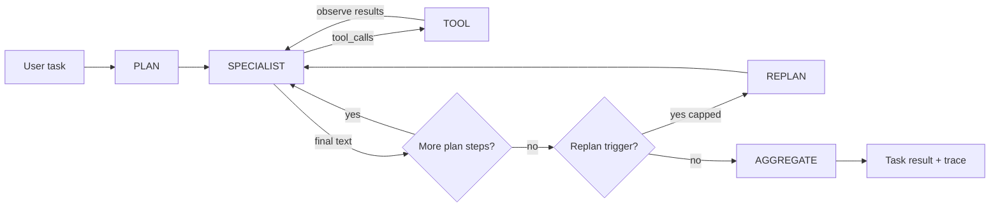
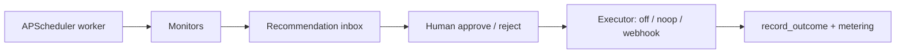
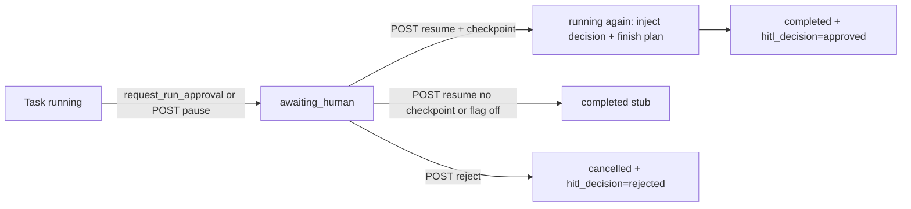
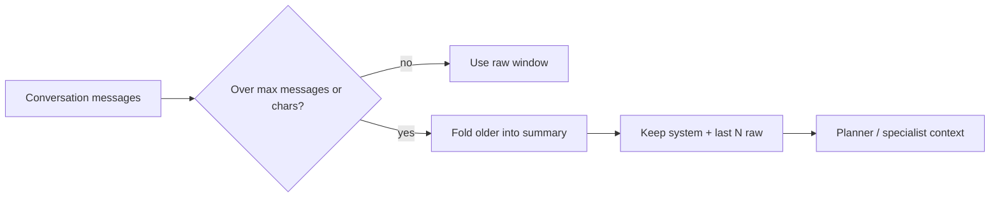
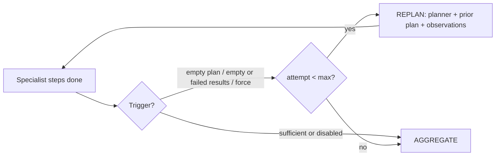

# Architecture — agent harness loop

ProAgent OS is a **product harness**, not a chain library. The runtime that
matters commercially is the explicit agent loop: plan, call specialists with
tools, observe results, then decide a final answer — with a separate proactive
path that asks a human before side effects.

This document maps that loop to public patterns from major agent platforms and
papers, and points at the thin code hooks in `proagent_os/harness/loop.py`.

## Outer loop (task run)

| Phase | Wire value | Who | Notes |
| --- | --- | --- | --- |
| Plan | `plan` | Planner agent (text-only) | Emits JSON steps `{agent, goal, tools}` |
| Specialist | `specialist` | Researcher / analyst / vertical | One LLM turn; may request tools |
| Tool | `tool` | Tool registry | Execute, return observation to the specialist |
| Aggregate | `aggregate` | Aggregator (text-only) | Synthesize step results |
| Replan | `replan` | Planner again (optional) | After specialists; heuristic triggers; capped |

Constants: `LoopPhase` in `proagent_os/harness/loop.py`. Orchestrator writes
trace rows through `event(...)`. Helpers `tool_trajectory` / `summarize_run`
feed the golden-task eval stub in `proagent_os/eval/` (ordered-subset; not an LLM judge).

## Inner loop (specialist tool rounds)

Matches the industry agentic tool loop:

1. Call the model with tool schemas.
2. If there are tool calls → run them → append observations → goto 1.
3. If there is a final text answer (no tool calls) → stop.
4. Cap with `PROAGENT_MAX_TOOL_ROUNDS` (forced final text turn).

This is the same shape as OpenAI’s Agents SDK runner loop and Anthropic’s
client-side `while stop_reason == tool_use` guidance. ProAgent already did this
in `Orchestrator._run_specialist`; the phase constants make it inspectable.

## Proactive HITL loop (separate from task runs)

Approvals are **product pauses**, not a new chat turn — the same distinction
OpenAI documents for run interruptions. Executors never treat the action payload
as a URL or shell command (`proagent_os/proactive/executors.py`).

## Task-run HITL pause / resume (mid-loop continue)

Aligns with OpenAI Agents **run interruptions** + `RunState.approve` /
`Runner.run(agent, state)`, Anthropic computer-use **confirm consequential
actions**, and LangGraph **interrupt + `Command(resume=...)`** — without
replacing the recommendation inbox.

| Piece | Behavior now | Still planned |
| --- | --- | --- |
| Status | `running` → `awaiting_human` → (approve) continue → `completed`, or reject → `cancelled` | Dedicated task audit table |
| Trigger | Tool with `requires_human_approval` (builtin `request_run_approval`) or `POST /api/v1/tasks/{id}/pause` | Guardrail / policy interrupts mid-tool batch |
| Payload | `pending_action_json` opaque JSON; never URL/shell | Typed action schemas + dry-run previews |
| Checkpoint | `hitl_checkpoint_json` (migration `0006`): plan, completed steps, pause locus | Full message-history / tool-call replay |
| Decide API | `POST .../resume`, `POST .../reject` (RBAC reuses `recommendation.decide`) | Dedicated `task.decide` permission |
| Orchestrator | On approve with checkpoint + `PROAGENT_HITL_RESUME_CONTINUE=true` (default): inject human decision into the paused specialist, run remaining plan steps, aggregate. Flag false or no checkpoint: legacy mark-completed stub. Reject never continues. | Execute gated side-effect tools after approve |

Toggle: `PROAGENT_HITL_RESUME_CONTINUE` (default `true`). Reject/cancel paths are
unchanged either way.

Code: `proagent_os/harness/hitl.py`, `Orchestrator.resume_after_hitl`, migrations
`0005_task_hitl_pause` + `0006_hitl_checkpoint`. Trace phase `hitl`
(`LoopPhase.HITL`). Proactive `emit_recommendation` is unchanged.

## Industry references (prefer official)

| Theme | Source | URL |
| --- | --- | --- |
| Explicit agent / runner loop | OpenAI — Running agents | https://developers.openai.com/api/docs/guides/agents/running-agents |
| Agents SDK primitives + tracing | OpenAI Agents SDK | https://openai.github.io/openai-agents-python/ |
| Client tool-use agentic loop | Anthropic — How tool use works | https://platform.claude.com/docs/en/agents-and-tools/tool-use/how-tool-use-works |
| Computer-use + human confirm for consequential actions | Anthropic — Computer use tool | https://platform.claude.com/docs/en/agents-and-tools/tool-use/computer-use-tool |
| HITL interrupt / resume | OpenAI Agents — Human-in-the-loop | https://openai.github.io/openai-agents-python/human_in_the_loop/ |
| Graph interrupt + resume value | LangGraph — Interrupts | https://docs.langchain.com/oss/python/langgraph/interrupts |
| Plan-and-execute vs ReAct | LangChain blog — Plan-and-Execute Agents | https://www.langchain.com/blog/planning-agents |
| Trajectory / tool-path evaluation | LangSmith — Evaluate a complex agent | https://docs.langchain.com/langsmith/evaluate-complex-agent |
| Multi-agent runtime + eval criteria | Google ADK | https://docs.cloud.google.com/gemini-enterprise-agent-platform/build/adk |
| ADK trajectory criteria | Google ADK — Evaluation criteria | https://adk.dev/evaluate/criteria/ |
| ReAct (reason + act interleaved) | Yao et al., 2022 | https://arxiv.org/abs/2210.03629 |
| Toolformer (self-supervised tool APIs) | Schick et al., 2023 | https://arxiv.org/abs/2302.04761 |
| Plan-and-Solve prompting | Wang et al., 2023 | https://arxiv.org/abs/2305.04091 |
| Session / context compaction | OpenAI sessions + Anthropic long-context practice | See MEMORY.md |

ProAgent’s planner → specialists → aggregator is closest to **plan-and-execute**;
each specialist’s tool rounds are a **ReAct-style** inner loop; optional
`LoopPhase.REPLAN` is the outer revise ring (Plan-and-Solve shaped). We do not
vendor LangGraph/CrewAI; we keep a small FastAPI + SQLite product shell.

## Session / context compaction (stub)

Long chats are compacted before planner/specialist prompts so the model window
stays bounded — aligned with OpenAI session/conversation management and
Anthropic’s “keep recent tool results, compress older history” practice.

| Piece | Now (stub) | Planned |
| --- | --- | --- |
| Trigger | `PROAGENT_COMPACTION_MAX_MESSAGES` / `MAX_CHARS` | Per-tenant token budgets |
| Strategy | Keep system + last N; extractive summary of older | LLM summarizer; structured memory objects |
| Tokens | `approx_chars` | Optional tiktoken / provider usage |
| Audit | `summary` message meta + `tenant_memory` kind=`compaction`; trace phase `compaction` | Compaction event table / dashboards |
| Wire-up | `ConversationMemory.compact_if_needed` + prior-context block in orchestrator | Full session object shared across runner turns |

Details and env knobs: [MEMORY.md](MEMORY.md).

## Plan-and-replan outer loop (stub)

Aligns with **LangGraph plan-and-execute** (execute then optionally replan) and
**Plan-and-Solve** (arxiv 2305.04091: revise the plan). The specialist
ReAct-style tool loop is unchanged; this is the OUTER planner ring.

| Piece | Now (stub) | Planned |
| --- | --- | --- |
| Knob | `PROAGENT_REPLAN_ENABLED` default **false** (zero behavior change); `PROAGENT_REPLAN_MAX` default 1; `PROAGENT_REPLAN_FORCE` fixtures/demos only | Per-tenant / per-vertical policy |
| Triggers | Empty plan; empty step results; empty aggregate inputs; all steps failed (heuristic); force | LLM judge of sufficiency; structured critique |
| Planner input | Prior plan JSON + observations summary | Diff-aware revision; step-level retry only |
| Trace | `LoopPhase.REPLAN` decision event + planner output (`replan: true`) | Cost / latency budgets on replan ring |
| Scope | Whole-plan re-call then re-run steps | DAG replanning; skip succeeded steps |

Code: `proagent_os/harness/replan.py`, hooks in `orchestrator.py`. HITL pause
still short-circuits the replan ring (human decides next).

## Tool schema hardening (stub)

Arguments from the model are checked against each tool's `parameters` JSON schema
before `Tool.run` (OpenAI FunctionTool / Anthropic tool_use). Failures become
specialist observations with `schema_validation_failed`; the tool does not execute.
Knob: `PROAGENT_TOOL_SCHEMA_STRICT` (default on). Details: [TOOLS.md](TOOLS.md).

## Stub vs planned

| Shipped now | Planned (not in this cut) |
| --- | --- |
| Typed `LoopPhase` + `event()` trace hooks | Richer phase dashboards / live traces |
| `tool_trajectory` / `summarize_run` helpers | Exact-match / ADK numeric trajectory scores |
| Golden-task runner + ordered-subset CI asserts (`proagent_os/eval/`) | LLM-as-judge + live LangSmith datasets |
| Docs mapping to platform patterns | Guardrail interrupts mid-tool-batch with policy engines |
| Task-run HITL mid-loop resume (`awaiting_human` + checkpoint) | Full tool-call replay; dedicated task audit; gated tool execute |
| Session / conversation compaction stub (`summary` + keep last N) | LLM summarizer, tiktoken budgets, per-tenant limits |
| Tool JSON-schema validation before execute (`PROAGENT_TOOL_SCHEMA_STRICT`) | Pydantic models / OpenAI strict mode / per-tool timeout+approval |
| Plan-and-replan outer loop stub (`PROAGENT_REPLAN_*`, default off) | LLM sufficiency judge, DAG replan, cost budgets |
| Existing OTel + usage metering stubs | Full LangSmith/ADK-style judges |

Default `PROAGENT_LLM_PROVIDER=mock` stays offline and green. See [EVAL.md](EVAL.md)
for fixture layout and matching rules.

## Related code

- `proagent_os/harness/orchestrator.py` — outer + inner loops
- `proagent_os/harness/loop.py` — phases and trajectory helpers
- `proagent_os/eval/` — golden-task loader + trajectory compare stub
- `proagent_os/professional/tools/` — JSON-schema tools / OpenAI function wire format + arg validation
- `proagent_os/harness/hitl.py` — task-run pause / resume (mid-loop continue) / reject
- `proagent_os/harness/memory.py` / `compaction.py` — conversation store + session compaction stub
- `proagent_os/proactive/` — monitors, recommendations, executors
- `docs/AUTH.md`, `docs/DATABASE.md`, `docs/DEMO.md`, `docs/EVAL.md`, `docs/MEMORY.md`, `docs/TOOLS.md`, `docs/VERTICAL_SKILL.md`
