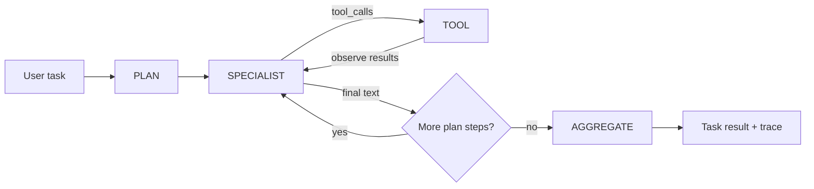
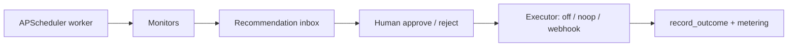

# Architecture — agent harness loop

ProAgent OS is a **product harness**, not a chain library. The runtime that
matters commercially is the explicit agent loop: plan, call specialists with
tools, observe results, then decide a final answer — with a separate proactive
path that asks a human before side effects.

This document maps that loop to public patterns from major agent platforms and
papers, and points at the thin code hooks in `proagent_os/harness/loop.py`.

## Outer loop (task run)

| Phase | Wire value | Who | Notes |
| --- | --- | --- | --- |
| Plan | `plan` | Planner agent (text-only) | Emits JSON steps `{agent, goal, tools}` |
| Specialist | `specialist` | Researcher / analyst / vertical | One LLM turn; may request tools |
| Tool | `tool` | Tool registry | Execute, return observation to the specialist |
| Aggregate | `aggregate` | Aggregator (text-only) | Synthesize step results |

Constants: `LoopPhase` in `proagent_os/harness/loop.py`. Orchestrator writes
trace rows through `event(...)`. Helpers `tool_trajectory` / `summarize_run`
feed the golden-task eval stub in `proagent_os/eval/` (ordered-subset; not an LLM judge).

## Inner loop (specialist tool rounds)

Matches the industry agentic tool loop:

1. Call the model with tool schemas.
2. If there are tool calls → run them → append observations → goto 1.
3. If there is a final text answer (no tool calls) → stop.
4. Cap with `PROAGENT_MAX_TOOL_ROUNDS` (forced final text turn).

This is the same shape as OpenAI’s Agents SDK runner loop and Anthropic’s
client-side `while stop_reason == tool_use` guidance. ProAgent already did this
in `Orchestrator._run_specialist`; the phase constants make it inspectable.

## Proactive HITL loop (separate from task runs)

Approvals are **product pauses**, not a new chat turn — the same distinction
OpenAI documents for run interruptions. Executors never treat the action payload
as a URL or shell command (`proagent_os/proactive/executors.py`).

## Industry references (prefer official)

| Theme | Source | URL |
| --- | --- | --- |
| Explicit agent / runner loop | OpenAI — Running agents | https://developers.openai.com/api/docs/guides/agents/running-agents |
| Agents SDK primitives + tracing | OpenAI Agents SDK | https://openai.github.io/openai-agents-python/ |
| Client tool-use agentic loop | Anthropic — How tool use works | https://platform.claude.com/docs/en/agents-and-tools/tool-use/how-tool-use-works |
| Computer-use + human confirm for consequential actions | Anthropic — Computer use tool | https://platform.claude.com/docs/en/agents-and-tools/tool-use/computer-use-tool |
| Plan-and-execute vs ReAct | LangChain blog — Plan-and-Execute Agents | https://www.langchain.com/blog/planning-agents |
| Trajectory / tool-path evaluation | LangSmith — Evaluate a complex agent | https://docs.langchain.com/langsmith/evaluate-complex-agent |
| Multi-agent runtime + eval criteria | Google ADK | https://docs.cloud.google.com/gemini-enterprise-agent-platform/build/adk |
| ADK trajectory criteria | Google ADK — Evaluation criteria | https://adk.dev/evaluate/criteria/ |
| ReAct (reason + act interleaved) | Yao et al., 2022 | https://arxiv.org/abs/2210.03629 |
| Toolformer (self-supervised tool APIs) | Schick et al., 2023 | https://arxiv.org/abs/2302.04761 |
| Plan-and-Solve prompting | Wang et al., 2023 | https://arxiv.org/abs/2305.04091 |

ProAgent’s planner → specialists → aggregator is closest to **plan-and-execute**;
each specialist’s tool rounds are a **ReAct-style** inner loop. We do not vendor
LangGraph/CrewAI; we keep a small FastAPI + SQLite product shell.

## Stub vs planned

| Shipped now | Planned (not in this cut) |
| --- | --- |
| Typed `LoopPhase` + `event()` trace hooks | Session/thread compaction for long chats |
| `tool_trajectory` / `summarize_run` helpers | Exact-match / ADK numeric trajectory scores |
| Golden-task runner + ordered-subset CI asserts (`proagent_os/eval/`) | LLM-as-judge + live LangSmith datasets |
| Docs mapping to platform patterns | Guardrail interrupts that pause mid-specialist |
| Existing OTel + usage metering stubs | Full LangSmith/ADK-style judges |

Default `PROAGENT_LLM_PROVIDER=mock` stays offline and green. See [EVAL.md](EVAL.md)
for fixture layout and matching rules.

## Related code

- `proagent_os/harness/orchestrator.py` — outer + inner loops
- `proagent_os/harness/loop.py` — phases and trajectory helpers
- `proagent_os/eval/` — golden-task loader + trajectory compare stub
- `proagent_os/professional/tools/` — JSON-schema tools / OpenAI function wire format
- `proagent_os/proactive/` — monitors, recommendations, executors
- `docs/AUTH.md`, `docs/DATABASE.md`, `docs/DEMO.md`, `docs/EVAL.md`, `docs/VERTICAL_SKILL.md`
